# BookingGym: Documentación de Implementación Técnica

**Proyecto:** Sistema de reservas de gimnasio con dos estrategias de comunicación entre microservicios  
**Repositorio:** [`github.com/arielhurtado/springbootexamples/BokingGymNewVersion`](https://github.com/arielhurtado/springbootexamples/tree/main/BokingGymNewVersion)  
**Versión:** 1.0  
**Fecha:** Octubre 2026

> **Alcance**: Este documento describe dos implementaciones del mismo dominio (reservas de gimnasio) que difieren únicamente en la **estrategia de comunicación** entre microservicios. La primera usa **comunicación síncrona vía Feign**; la segunda usa **comunicación asíncrona vía RabbitMQ**. Ambas comparten el mismo modelo de dominio.

---

## Tabla de contenido

1. [Introducción](#1-introducción)
2. [Modelo de dominio compartido](#2-modelo-de-dominio-compartido)
3. [Caso 1 — Comunicación síncrona (Feign)](#3-caso-1--comunicación-síncrona-feign)
4. [Caso 2 — Comunicación asíncrona (RabbitMQ)](#4-caso-2--comunicación-asíncrona-rabbitmq)
5. [Contraste: síncrono vs asíncrono](#5-contraste-síncrono-vs-asíncrono)
6. [Atributos de calidad y tácticas](#6-atributos-de-calidad-y-tácticas)
7. [Estilos arquitectónicos presentes](#7-estilos-arquitectónicos-presentes)

---

## 1. Introducción

El proyecto **BokingGymNewVersion** contiene dos implementaciones del mismo sistema de reservas de gimnasio. En ambos casos hay dos microservicios Spring Boot independientes:

- **MS Booking** (puerto 8080): gestiona las reservas de clases de gimnasio.
- **MS Information** (puerto 8081): gestiona el registro y consulta de usuarios.

Cada microservicio mantiene su **propia base de datos PostgreSQL** (patrón *Database per Service*). Ambos comparten el mismo modelo de dominio (`User`, `Booking`, `GymClass`), pero difieren en **cómo colaboran**:

| Caso | Estrategia | Dirección del flujo |
|---|---|---|
| **Caso 1** | Comunicación síncrona con **Feign** | MS Booking → MS Information (llamada REST en el momento) |
| **Caso 2** | Comunicación asíncrona con **RabbitMQ** | MS Information → cola → MS Booking (evento publicado al registrar un usuario) |

La diferencia es importante: en el caso síncrono, **Booking pide** los datos cuando los necesita. En el caso asíncrono, **Information publica** los datos cuando ocurren, y Booking los **recibe** y guarda una copia local en su propia base de datos. Por eso, en el caso asíncrono, Booking **no necesita conectarse a Information** cuando crea una reserva: ya tiene su copia local del usuario.

---

## 2. Modelo de dominio compartido

Ambos casos comparten las mismas clases de dominio. Las principales:

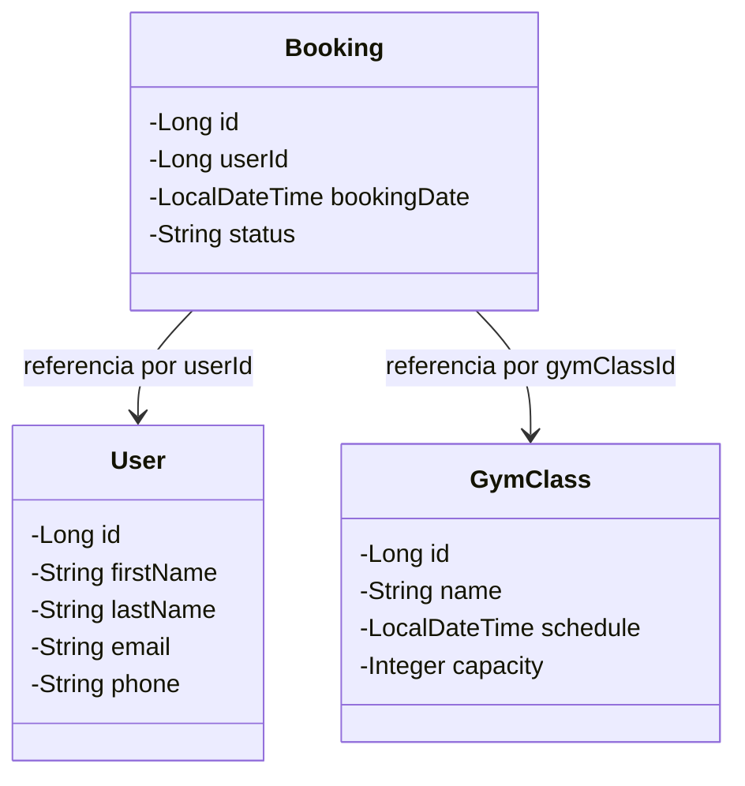

**Nota**: las entidades **no se referencian directamente con `@ManyToOne`**, sino por identificador (`userId`, `gymClassId`). Esta es una decisión deliberada: cada microservicio guarda solo lo que necesita, sin crear dependencias de objetos entre servicios.

---

## 3. Caso 1 — Comunicación síncrona (Feign)

### 3.1 Vista de contexto

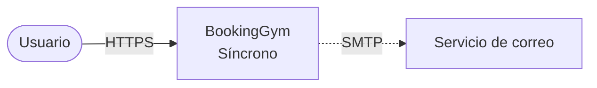

### 3.2 Vista de contenedores

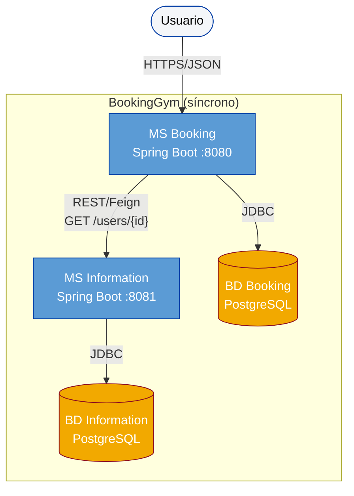

**Punto clave**: en este caso, **MS Booking llama a MS Information** en el momento en que necesita los datos del usuario. La flecha va de Booking hacia Information.

### 3.3 Vista de componentes — MS Booking

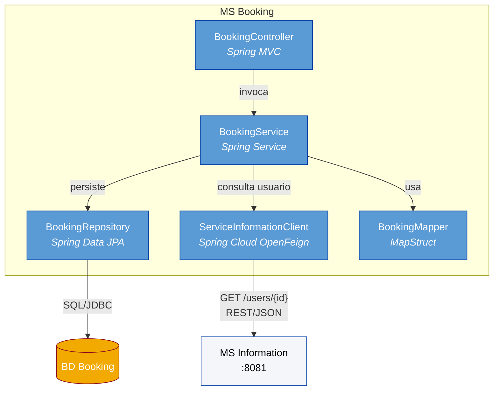

### 3.4 Vista de componentes — MS Information

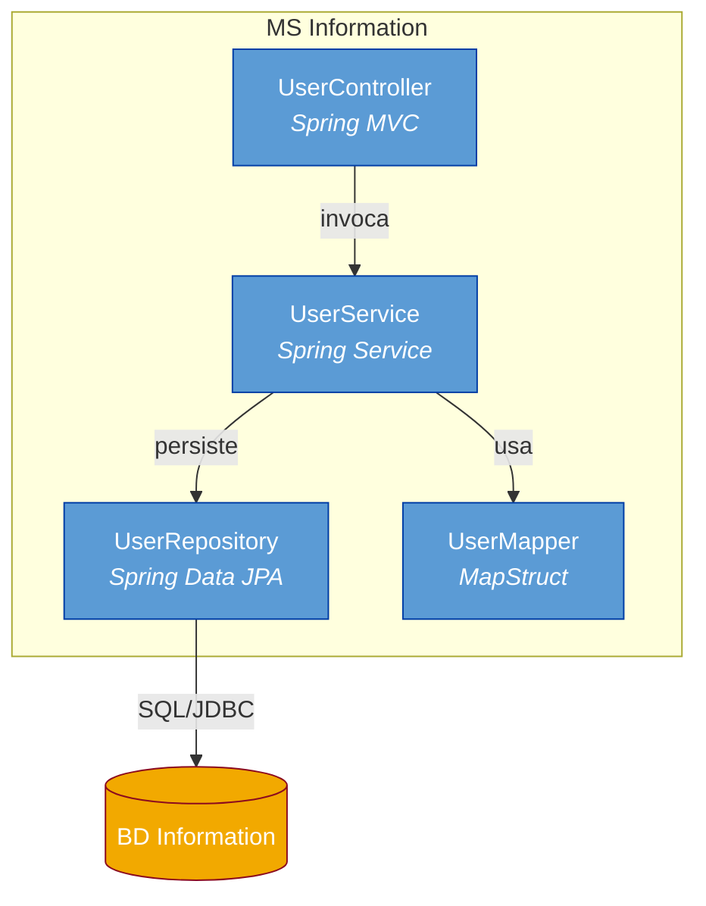

### 3.5 Diagrama de secuencia

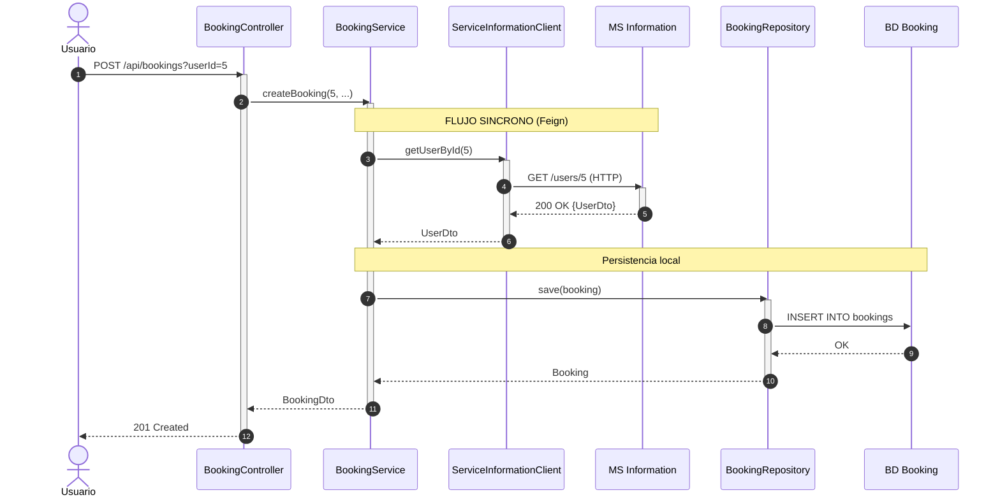

**Observaciones**:

- El bloque entre `S` y `I` es **bloqueante**: la operación no puede continuar sin la respuesta.
- Si `MS Information` cae, `MS Booking` **no puede completar la reserva**.
- La consistencia es **fuerte**: al terminar la transacción, el usuario existe y la reserva está persistida.

### 3.6 Código Java — Caso 1

**Cliente Feign:**

```java
@FeignClient(name = "information-microservice",
             url = "http://localhost:8081/api/information")
public interface ServiceInformationClient {

    @GetMapping("/users/{id}")
    UserDto getUserById(@PathVariable("id") Long id);
}
```

**Servicio de Booking:**

```java
@Service
public class BookingService {

    private final BookingRepository bookingRepository;
    private final ServiceInformationClient informationClient;
    private final BookingMapper bookingMapper;

    public BookingService(BookingRepository bookingRepository,
                          ServiceInformationClient informationClient,
                          BookingMapper bookingMapper) {
        this.bookingRepository = bookingRepository;
        this.informationClient = informationClient;
        this.bookingMapper = bookingMapper;
    }

    @Transactional
    public BookingDto createBooking(Long userId, Long gymClassId,
                                    BookingDto bookingDto) {
        try {
            // Llamada sincrona al MS Information
            UserDto user = informationClient.getUserById(userId);

            Booking booking = new Booking();
            booking.setUserId(userId);
            booking.setBookingDate(LocalDateTime.now());
            booking.setStatus("CONFIRMED");

            Booking saved = bookingRepository.save(booking);
            return bookingMapper.toDto(saved);

        } catch (FeignException.NotFound e) {
            throw new EntityNotFoundException(
                "El usuario con ID " + userId + " no existe");
        } catch (FeignException e) {
            throw new RuntimeException(
                "Error al invocar el microservicio de informacion: "
                + e.getMessage(), e);
        }
    }
}
```

**Aplicación principal:**

```java
@SpringBootApplication
@EnableFeignClients
public class BookingApplication {
    public static void main(String[] args) {
        SpringApplication.run(BookingApplication.class, args);
    }
}
```

---

## 4. Caso 2 — Comunicación asíncrona (RabbitMQ)

### 4.1 Vista de contexto

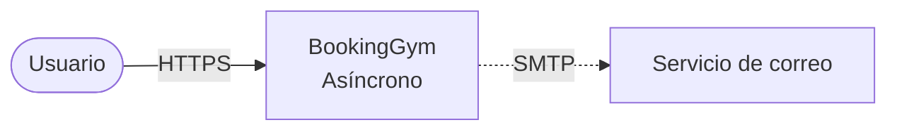

### 4.2 Vista de contenedores

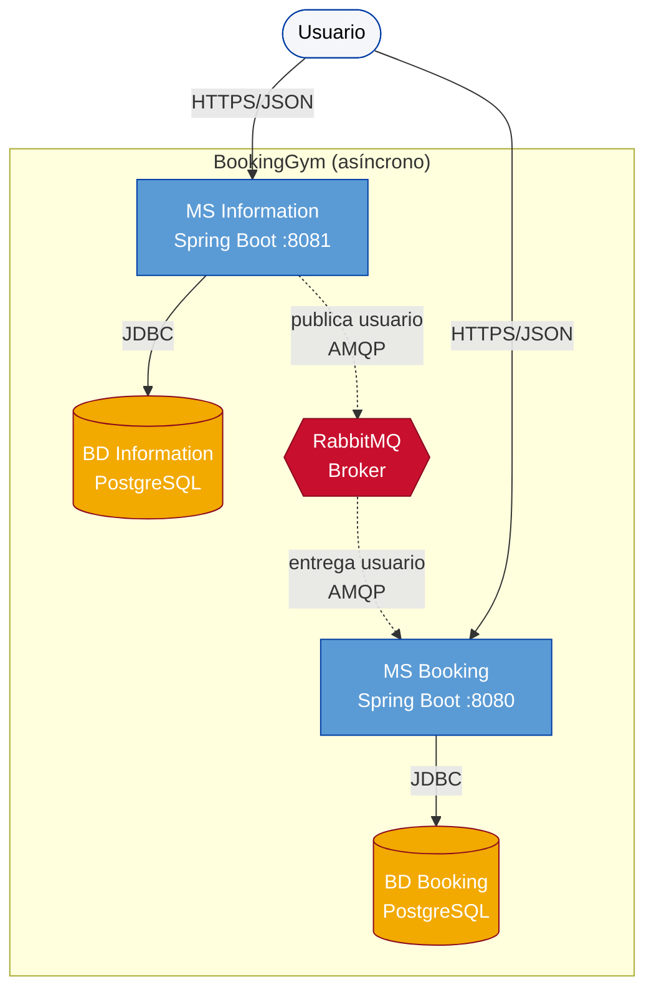

**Punto clave**: la flecha de comunicación va de **MS Information hacia MS Booking**, pasando por el broker. Information **publica**; Booking **consume**. No hay llamada directa entre ellos.

### 4.3 Vista de componentes — MS Information (productor)

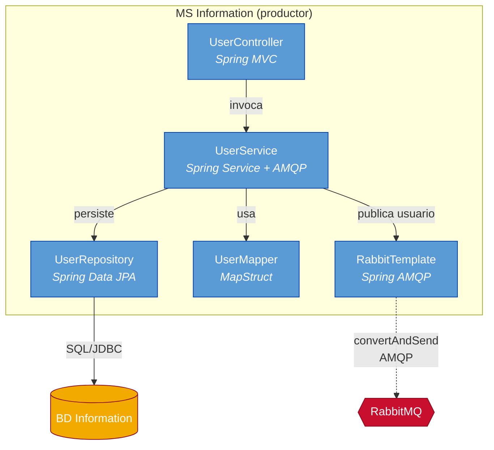

### 4.4 Vista de componentes — MS Booking (consumidor)

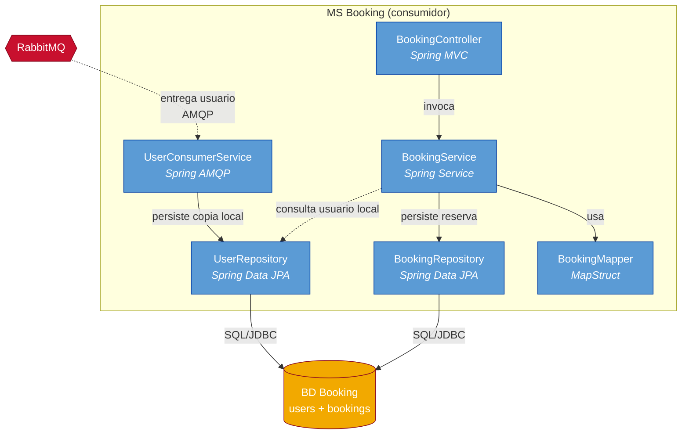

**Punto clave**: Booking tiene su **propia tabla `users`**, alimentada por el `UserConsumerService`. Cuando se crea una reserva, `BookingService` **no llama a Information**: consulta la copia local. Esta es la esencia del desacoplamiento asíncrono.

### 4.5 Diagrama de secuencia — Registro de usuario (publicación)

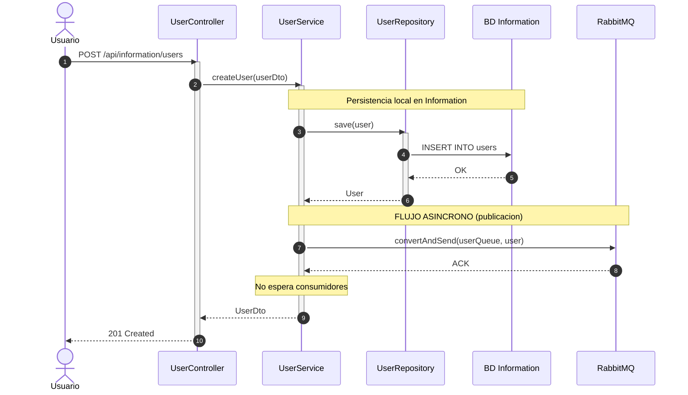

### 4.6 Diagrama de secuencia — Consumo y creación de reserva

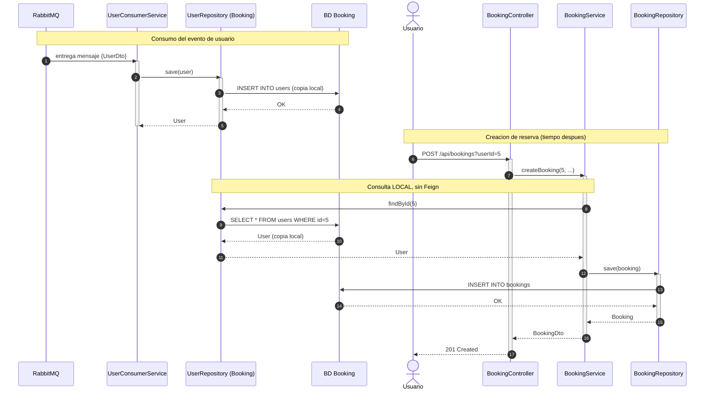

**Observaciones**:

- El registro del usuario y la creación de la reserva son **eventos separados en el tiempo**. Information no sabe cuándo Booking creará una reserva.
- Booking **no se conecta a Information** para crear la reserva. Consulta su copia local.
- La consistencia es **eventual**: hay un lapso entre la publicación y el consumo durante el cual Booking no tiene el usuario. Si en ese lapso llega una petición de reserva, Booking no encuentra al usuario.
- El productor (Information) **no conoce** al consumidor (Booking).

### 4.7 Código Java — Caso 2

**Productor — UserService en MS Information:**

```java
@Service
public class UserService {

    private final UserRepository userRepository;
    private final RabbitTemplate rabbitTemplate;
    private final UserMapper userMapper;

    public UserService(UserRepository userRepository,
                       RabbitTemplate rabbitTemplate,
                       UserMapper userMapper) {
        this.userRepository = userRepository;
        this.rabbitTemplate = rabbitTemplate;
        this.userMapper = userMapper;
    }

    @Transactional
    public UserDto createUser(UserDto userDto) {
        // 1. Persiste localmente
        User user = userMapper.toEntity(userDto);
        User saved = userRepository.save(user);

        // 2. Publica el evento a la cola
        UserDto savedDto = userMapper.toDto(saved);
        rabbitTemplate.convertAndSend(
            RabbitMQConfig.USER_QUEUE, savedDto);

        return savedDto;
    }
}
```

**Consumidor — UserConsumerService en MS Booking:**

```java
@Service
public class UserConsumerService {

    private final UserRepository userRepository;
    private final UserMapper userMapper;

    public UserConsumerService(UserRepository userRepository,
                               UserMapper userMapper) {
        this.userRepository = userRepository;
        this.userMapper = userMapper;
    }

    @RabbitListener(queues = RabbitMQConfig.USER_QUEUE)
    public void receiveUser(UserDto userDto) {
        // Guarda la copia local del usuario en la BD de Booking
        User user = userMapper.toEntity(userDto);
        userRepository.save(user);
        System.out.println("Usuario sincronizado: " + user.getEmail());
    }
}
```

**Servicio de Booking — consulta local, sin Feign:**

```java
@Service
public class BookingService {

    private final BookingRepository bookingRepository;
    private final UserRepository userRepository;   // BD local de Booking
    private final BookingMapper bookingMapper;

    public BookingService(BookingRepository bookingRepository,
                          UserRepository userRepository,
                          BookingMapper bookingMapper) {
        this.bookingRepository = bookingRepository;
        this.userRepository = userRepository;
        this.bookingMapper = bookingMapper;
    }

    @Transactional
    public BookingDto createBooking(Long userId, Long gymClassId,
                                    BookingDto bookingDto) {
        // Consulta la copia local, sin Feign
        User user = userRepository.findById(userId)
                .orElseThrow(() -> new EntityNotFoundException(
                    "Usuario no sincronizado aun: " + userId));

        Booking booking = new Booking();
        booking.setUserId(user.getId());
        booking.setBookingDate(LocalDateTime.now());
        booking.setStatus("CONFIRMED");

        Booking saved = bookingRepository.save(booking);
        return bookingMapper.toDto(saved);
    }
}
```

**Configuración de RabbitMQ:**

```java
@Configuration
public class RabbitMQConfig {

    public static final String USER_QUEUE = "userQueue";

    @Bean
    public Queue userQueue() {
        return new Queue(USER_QUEUE, true); // durable
    }

    @Bean
    public Jackson2JsonMessageConverter jsonMessageConverter() {
        return new Jackson2JsonMessageConverter();
    }

    @Bean
    public RabbitTemplate rabbitTemplate(ConnectionFactory cf) {
        RabbitTemplate template = new RabbitTemplate(cf);
        template.setMessageConverter(jsonMessageConverter());
        return template;
    }
}
```

---

## 5. Contraste: síncrono vs asíncrono

### 5.1 Tabla comparativa

| Atributo | Caso 1 — Síncrono (Feign) | Caso 2 — Asíncrono (RabbitMQ) |
|---|---|---|
| **Quién inicia la comunicación** | Booking (cliente) | Information (productor) |
| **Dirección** | Booking → Information | Information → cola → Booking |
| **Momento de la comunicación** | Cuando Booking necesita el dato | Cuando Information registra al usuario |
| **Booking conoce al usuario** | En el momento de la reserva, vía REST | Antes de la reserva, vía copia local |
| **Disponibilidad** | 🔴 Baja: si Information cae, Booking falla | 🟢 Alta: Booking trabaja con su copia local |
| **Escalabilidad** | 🟡 Media: la cadena crece con la carga | 🟢 Alta: el broker desacopla productor y consumidor |
| **Consistencia** | 🟢 Fuerte: el dato se obtiene en el momento | 🔴 Eventual: hay un lapso de sincronización |
| **Acoplamiento temporal** | 🔴 Fuerte: ambos servicios deben estar en línea | 🟢 Débil: no necesitan coincidir en el tiempo |
| **Complejidad operativa** | 🟢 Baja: solo HTTP | 🔴 Alta: hay un broker que mantener |
| **Depuración** | 🟢 Lineal | 🔴 No lineal |
| **Duplicación de datos** | 🟢 No hay duplicación | 🔴 El usuario vive en dos BDs |

### 5.2 Regla práctica de decisión

> **Caso 1 (síncrono)** es preferible cuando el dato es **crítico y volátil**, y no tiene sentido guardar una copia local.
> **Caso 2 (asíncrono)** es preferible cuando el dato es **estable**, y se puede mantener una copia local para desacoplar los servicios.

En BookingGym:

- **Síncrono**: útil si el usuario pudiera cambiar de estado (correo, teléfono) entre reservas y esos cambios debieran reflejarse al instante.
- **Asíncrono**: útil si el usuario rara vez cambia y se tolera un pequeño retraso de sincronización a cambio de que Booking pueda operar aun si Information está caído.

---

## 6. Atributos de calidad y tácticas

| Táctica | Atributo que promueve | Caso donde aparece |
|---|---|---|
| Encapsular estructura interna con DTOs | Modificabilidad, seguridad | Ambos |
| Una base de datos por servicio | Desplegabilidad, autonomía | Ambos |
| Comunicación síncrona con Feign | Consistencia fuerte, simplicidad | Caso 1 |
| Comunicación asíncrona con RabbitMQ | Disponibilidad, escalabilidad | Caso 2 |
| Copia local de usuario en Booking | Disponibilidad, desacoplamiento temporal | Caso 2 |
| Traducir excepciones técnicas a dominio | Modificabilidad | Caso 1 |
| Manejar idempotencia en consumidores | Disponibilidad | Caso 2 (necesario: los mensajes pueden duplicarse) |

**Trade-off fundamental entre los dos casos**:

- El **caso síncrono** privilegia la **consistencia fuerte** y la **simplicidad operativa**, a costa de un **acoplamiento temporal fuerte**.
- El **caso asíncrono** privilegia la **disponibilidad** y el **desacoplamiento temporal**, a costa de **consistencia eventual** y **complejidad operativa**.

No hay uno "mejor" que otro: dependen del contexto y de los atributos que el sistema priorice.

---

## 7. Estilos arquitectónicos presentes

En términos de la clasificación **Componentes y Conectores (C&C)** de Kruchten:

| Estilo | Caso 1 (síncrono) | Caso 2 (asíncrono) |
|---|---|---|
| **Cliente-servidor** | ✅ Booking → Information vía Feign | ❌ |
| **Publish-subscribe** | ❌ | ✅ Information publica, Booking consume |
| **Layered (capas)** | ✅ controller → service → repository | ✅ controller → service → repository |
| **Shared database** | ❌ (una BD por servicio) | ❌ (una BD por servicio, con copia local) |

Los dos casos comparten el estilo **layered** dentro de cada microservicio, pero difieren en el estilo de **conector** entre microservicios:

- **Caso 1**: conector **llamada-return** (REST).
- **Caso 2**: conector **publicación-suscripción** (AMQP).

Esta es la diferencia arquitectónica fundamental entre ambas implementaciones.

---

**Documentación generada para el proyecto BokingGymNewVersion**  
*Universidad del Cauca — Ingeniería de Software — Grupo IDIS*  
*Popayán, 2026*
