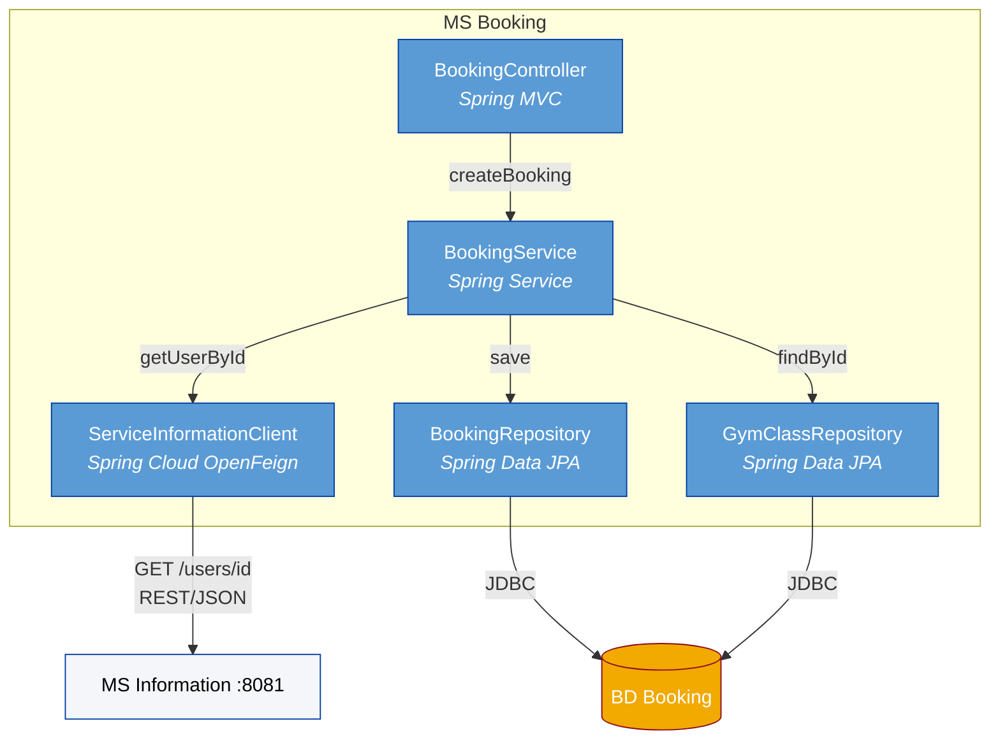
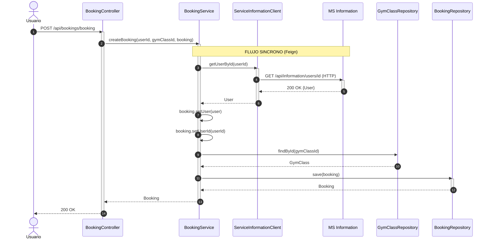
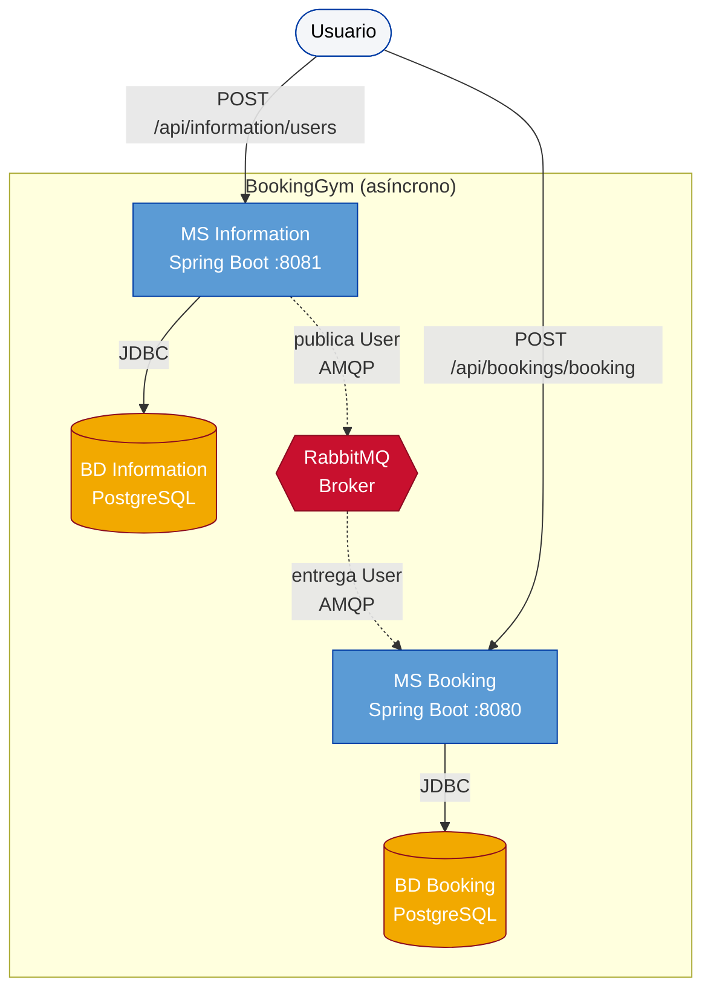
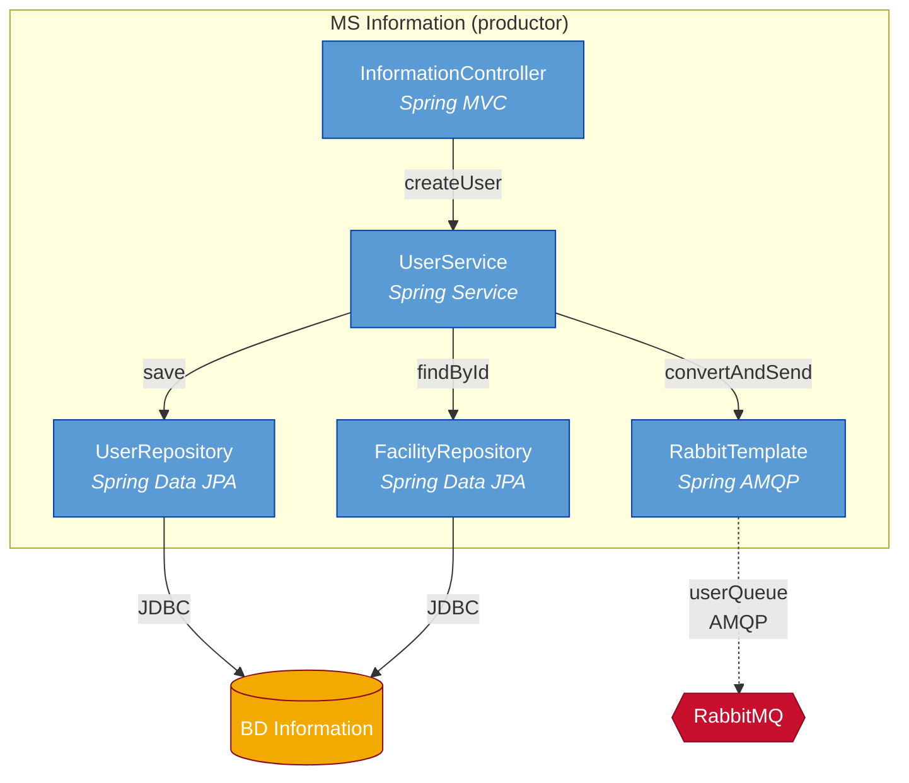
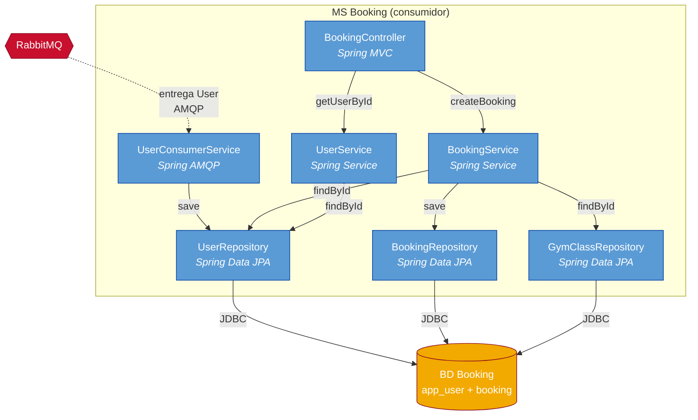
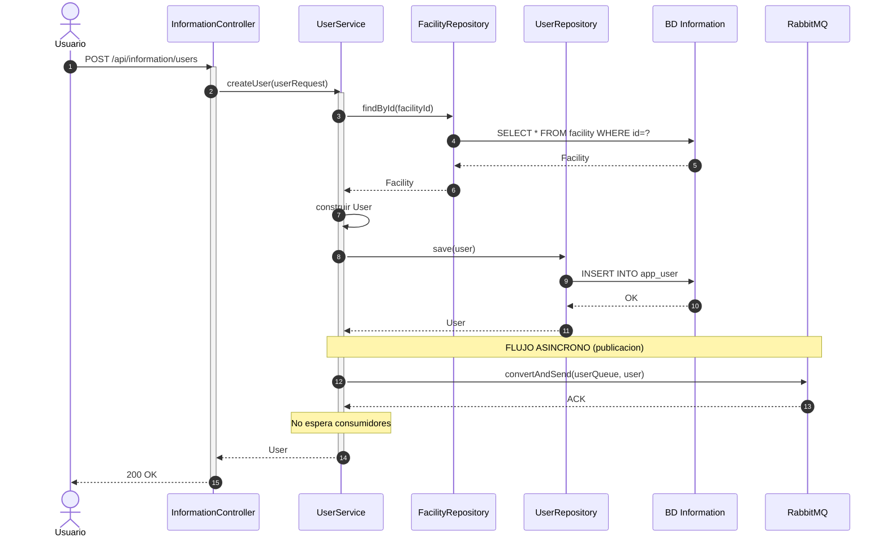
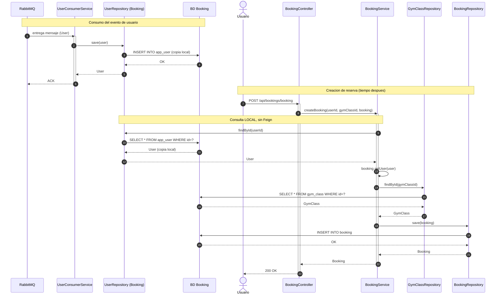

# BokingGymNewVersion: Documentación de Implementación Técnica

**Proyecto:** Sistema de reservas de gimnasio con dos estrategias de comunicación entre microservicios  
**Repositorio:** [`github.com/arielhurtado/springbootexamples/BokingGymNewVersion`](https://github.com/arielhurtado/springbootexamples/tree/main/BokingGymNewVersion)  
**Versión:** 1.0  
**Fecha:** Octubre 2026

> **Alcance**: Este documento describe dos implementaciones del mismo dominio (reservas de gimnasio) que difieren en la **estrategia de comunicación** entre microservicios. La primera usa **comunicación síncrona vía Feign**; la segunda usa **comunicación asíncrona vía RabbitMQ**. La diferencia no solo está en el conector: **el modelado del usuario cambia por completo entre ambos casos**.

---

## Tabla de contenido

1. [Introducción](#1-introducción)
2. [Caso 1 — Comunicación síncrona (Feign)](#2-caso-1--comunicación-síncrona-feign)
3. [Caso 2 — Comunicación asíncrona (RabbitMQ)](#3-caso-2--comunicación-asíncrona-rabbitmq)
4. [Contraste entre los dos casos](#4-contraste-entre-los-dos-casos)
5. [Atributos de calidad y tácticas](#5-atributos-de-calidad-y-tácticas)
6. [Estilos arquitectónicos presentes](#6-estilos-arquitectónicos-presentes)

---

## 1. Introducción

**BokingGymNewVersion** contiene dos implementaciones del mismo sistema de reservas de gimnasio. En ambos casos hay dos microservicios Spring Boot independientes:

- **MS Booking** (puerto 8080): gestiona las reservas.
- **MS Information** (puerto 8081): gestiona el registro de usuarios.

Cada microservicio mantiene su **propia base de datos PostgreSQL** (patrón *Database per Service*). Difieren en **cómo colaboran** y en **cómo modelan el usuario**:

| Aspecto | Caso 1 — Síncrono (Feign) | Caso 2 — Asíncrono (RabbitMQ) |
|---|---|---|
| **Dirección del flujo** | Booking → Information (REST al vuelo) | Information → cola → Booking |
| **`User` en Booking** | POJO `Serializable` (no entidad) | Entidad JPA `@Table(name = "app_user")` |
| **`Facility` en Booking** | POJO `Serializable` (no entidad) | Entidad JPA |
| **Relación `Booking` → `User`** | `@Transient User` + `Long UserId` | `@ManyToOne User` |
| **Persistencia del usuario en Booking** | ❌ No se persiste | ✅ Se persiste como copia local |
| **Conector** | REST (Feign) | AMQP (RabbitMQ) |

Esta diferencia es fundamental: en el caso síncrono, Booking no guarda usuarios; solo consulta a Information cuando los necesita. En el caso asíncrono, Booking **sí guarda una copia local del usuario**, y esa copia es la que usa para crear reservas.

---

## 2. Caso 1 — Comunicación síncrona (Feign)

### 2.1 Vista de contenedores


**Punto clave**: MS Booking llama a MS Information **en el momento** en que necesita los datos del usuario. La flecha va de Booking hacia Information.

### 2.2 Vista de componentes — MS Booking (cliente Feign)



**Punto clave**: en este caso, `BookingService` **no tiene un `UserRepository`**. Solo tiene el cliente Feign. El usuario **no se persiste** en Booking.

### 2.3 Diagrama de secuencia



### 2.4 Manejo de errores

`BookingController` captura los errores de Feign de forma diferenciada:

```java
try {
    Booking savedBooking = bookingService.createBooking(
        bookingRequest.getUserId(), bookingRequest.getGymClassId(), booking);
    return ResponseEntity.ok(savedBooking);
} catch (FeignException.NotFound e) {
    return ResponseEntity.status(HttpStatus.BAD_REQUEST)
        .body("{\"error\":\"Error guardando reserva, Id del usuario no existe.\"}");
} catch (FeignException e) {
    return ResponseEntity.status(HttpStatus.BAD_REQUEST)
        .body("{\"error\":\"Error invocando microservicio.\"}");
} catch (Exception e) {
    return ResponseEntity.status(HttpStatus.BAD_REQUEST)
        .body("{\"error\":\"" + e.getMessage() + "\"}");
}
```

**Observación**: `FeignException.NotFound` se lanza cuando Information responde `404`. Los demás errores de Feign (timeout, conexión rechazada, 500) caen en `FeignException`.

### 2.5 Modelado del `User` y `Facility`

En este caso, `User` y `Facility` son **POJOs `Serializable`**, no entidades JPA:

```java
public class User implements Serializable {
    private Long id;
    private String firstName;
    private String lastName;
    private Facility facility;
    // getters y setters
}

public class Facility implements Serializable {
    private Long id;
    private String address;
    private String city;
    // getters y setters
}
```

**Razón**: se usan solo como **contrato de deserialización** de la respuesta HTTP de Feign. No se persisten en la base de datos de Booking.

La entidad `Booking` en este caso:

```java
@Entity
public class Booking {

    @Id
    @GeneratedValue(strategy = GenerationType.SEQUENCE)
    private Long id;

    @Transient              // No se persiste: solo se usa en memoria
    private User user;

    private Long UserId;    // Sí se persiste: solo el ID del usuario

    private Date dateCreated;

    @ManyToOne
    @JoinColumn(name = "gymclass_id")
    private GymClass gymClass;
}
```

**Punto clave**: `@Transient` en `user` significa que JPA **no crea una columna** para ese campo. El usuario se usa durante la transacción (para la respuesta HTTP) pero no se persiste. Solo `UserId` (que sí se guarda como columna) queda en la BD.

### 2.6 Código Java — Caso 1

#### Cliente Feign

```java
package com.example.bookings.service;

import com.example.bookings.entity.User;
import org.springframework.cloud.openfeign.FeignClient;
import org.springframework.web.bind.annotation.GetMapping;
import org.springframework.web.bind.annotation.PathVariable;

@FeignClient(name = "information-microservice",
             url = "http://localhost:8081/api/information")
public interface ServiceInformationClient {

    @GetMapping("/users/{id}")
    User getUserById(@PathVariable("id") Long id);
}
```

#### Servicio de Booking

```java
@Service
public class BookingService implements IBookingService {

    private final BookingRepository bookingRepository;
    private final GymClassRepository gymClassRepository;
    private final ServiceInformationClient serviceInformationClient;

    public BookingService(BookingRepository bookingRepository,
                          GymClassRepository gymClassRepository,
                          ServiceInformationClient serviceInformationClient) {
        this.bookingRepository = bookingRepository;
        this.gymClassRepository = gymClassRepository;
        this.serviceInformationClient = serviceInformationClient;
    }

    @Override
    @Transactional
    public Booking createBooking(Long userId, Long gymClassId, Booking booking) {
        try {
            // Invoca el microservicio de Information
            System.out.println("Invocando servicio getUserById desde Booking-Microservice");

            User user = serviceInformationClient.getUserById(userId);
            booking.setUser(user);
            booking.setUserId(userId);

            Optional<GymClass> gymClass = gymClassRepository.findById(gymClassId);
            if (gymClass.isEmpty()) {
                throw new EntityNotFoundException(
                    "La clase con ID " + gymClassId + " no existe");
            }
            booking.setGymClass(gymClass.get());

            return bookingRepository.save(booking);

        } catch (FeignException.NotFound e) {
            throw new EntityNotFoundException(
                "El usuario con ID " + userId + " no existe");
        } catch (FeignException e) {
            throw new RuntimeException(
                "Error al invocar el microservicio de informacion: "
                + e.getMessage(), e);
        } catch (Exception e) {
            throw new RuntimeException(
                "Error al crear la reserva: " + e.getMessage(), e);
        }
    }
}
```

#### Aplicación principal

```java
@SpringBootApplication
@EnableFeignClients
public class BookingApplication {
    public static void main(String[] args) {
        SpringApplication.run(BookingApplication.class, args);
    }
}
```

**Nota**: `@EnableFeignClients` activa el escaneo de interfaces `@FeignClient`. Spring genera el proxy en tiempo de arranque y lo inyecta en `BookingService`.

---

## 3. Caso 2 — Comunicación asíncrona (RabbitMQ)

### 3.1 Vista de contenedores



**Punto clave**: MS Information **publica** el `User`; MS Booking **consume** y guarda una copia local en su propia base de datos.

### 3.2 Vista de componentes — MS Information (productor)



### 3.3 Vista de componentes — MS Booking (consumidor)



**Punto clave**: `BookingService` **no tiene Feign**. Consulta la copia local del usuario en `UserRepository`. El `UserConsumerService` es el único componente que recibe datos desde el exterior.

### 3.4 Diagrama de secuencia — Registro de usuario (publicación)



### 3.5 Diagrama de secuencia — Consumo y creación de reserva



**Observaciones**:

- El registro del usuario y la creación de la reserva son **eventos separados en el tiempo**.
- Booking **no se conecta a Information** para crear la reserva: consulta su copia local.
- La consistencia es **eventual**: hay un lapso entre la publicación y el consumo durante el cual Booking no tiene el usuario.
- El productor (Information) **no conoce** al consumidor (Booking).

### 3.6 Modelado del `User` y `Facility`

En este caso, `User` y `Facility` **sí son entidades JPA** en Booking:

```java
@Entity
@Table(name = "app_user")  // Evita el conflicto con 'user' (palabra reservada SQL)
public class User {

    @Id
    private Long id;        // Sin @GeneratedValue: el id viene de Information

    private String firstName;
    private String lastName;

    @ManyToOne
    @JoinColumn(name = "facility_id")
    private Facility facility;
}
```

**Punto clave**: `@Id` sin `@GeneratedValue`. El identificador viene asignado por Information. Booking solo lo persiste.

La entidad `Booking` en este caso:

```java
@Entity
public class Booking {

    @Id
    @GeneratedValue(strategy = GenerationType.SEQUENCE)
    private Long id;

    @ManyToOne
    @JoinColumn(name = "user_id")
    private User user;      // Relación JPA real

    private Date dateCreated;

    @ManyToOne
    @JoinColumn(name = "gymclass_id")
    private GymClass gymClass;
}
```

**Punto clave**: `@ManyToOne` en `user` significa que JPA **crea una columna `user_id`** y una clave foránea a la tabla `app_user`. El usuario **sí vive** en la base de datos de Booking.

### 3.7 Código Java — Caso 2

#### 3.7.1 Configuración de RabbitMQ (MS Information)

```java
package com.example.bookings.infra.config;

import org.springframework.amqp.core.Queue;
import org.springframework.amqp.rabbit.core.RabbitTemplate;
import org.springframework.amqp.rabbit.connection.ConnectionFactory;
import org.springframework.amqp.support.converter.Jackson2JsonMessageConverter;
import org.springframework.context.annotation.Bean;
import org.springframework.context.annotation.Configuration;

@Configuration
public class RabbitMQConfig {

    public static final String USER_QUEUE = "userQueue";

    @Bean
    public Queue userQueue() {
        return new Queue(USER_QUEUE, true);
    }

    @Bean
    public RabbitTemplate rabbitTemplate(ConnectionFactory connectionFactory) {
        RabbitTemplate rabbitTemplate = new RabbitTemplate(connectionFactory);
        rabbitTemplate.setMessageConverter(jsonMessageConverter());
        return rabbitTemplate;
    }

    @Bean
    public Jackson2JsonMessageConverter jsonMessageConverter() {
        return new Jackson2JsonMessageConverter();
    }
}
```

**Observación**: aquí **sí** se declara el `RabbitTemplate` explícitamente, con el conversor JSON asignado. En el caso de Booking (consumidor), esta configuración no es necesaria porque Spring Boot auto-configura el listener con el conversor disponible.

#### 3.7.2 Productor — `UserService` en MS Information

```java
@Service
public class UserService implements IUserService {

    @Autowired
    private RabbitTemplate rabbitTemplate;

    @Autowired
    private UserRepository userRepository;

    @Autowired
    private FacilityRepository facilityRepository;

    @Override
    @Transactional
    public User createUser(UserRequest userRequest) throws Exception {
        try {
            // 1. Validar existencia de la instalación
            Optional<Facility> facilityOpt = facilityRepository
                .findById(userRequest.getFacilityId());
            if (facilityOpt.isEmpty()) {
                throw new IllegalAccessException(
                    "La instalacion con ID " + userRequest.getFacilityId() + " no existe");
            }

            // 2. Verificar si el ID fue pasado y si ya existe
            if (userRequest.getId() != null) {
                if (userRepository.findById(userRequest.getId()).isPresent()) {
                    throw new IllegalAccessException(
                        "El usuario con ID " + userRequest.getId() + " ya existe");
                }
            }

            // 3. Crear y mapear el usuario desde el DTO
            User user = new User();
            user.setId(userRequest.getId());
            user.setFirstName(userRequest.getFirstName());
            user.setLastName(userRequest.getLastName());
            user.setFacility(facilityOpt.get());

            // 4. Guardar el usuario
            User userSaved = userRepository.save(user);

            // 5. Publicar en RabbitMQ
            rabbitTemplate.convertAndSend(RabbitMQConfig.USER_QUEUE, userSaved);

            return userSaved;

        } catch (Exception e) {
            throw new Exception(e.getMessage());
        }
    }
}
```

**Punto clave**: el método hace **cinco cosas**: valida la instalación, valida que el usuario no exista, construye la entidad, la persiste localmente, y **publica el evento**. La publicación ocurre **después** del `save`, lo cual es coherente: solo se publica lo que ya está persistido.

#### 3.7.3 Consumidor — `UserConsumerService` en MS Booking

```java
@Service
public class UserConsumerService {

    @Autowired
    private UserRepository userRepository;

    @RabbitListener(queues = RabbitMQConfig.USER_QUEUE)
    public void receiveMessage(User user) {
        try {
            userRepository.save(user);
            System.out.println("Recibido usuario: "
                + user.getFirstName() + " " + user.getLastName());
        } catch (Exception e) {
            System.out.println("Error:" + e.getMessage());
        }
    }
}
```

**Observaciones**:

- `@RabbitListener(queues = USER_QUEUE)` marca el método como consumidor del canal `userQueue`.
- Recibe directamente la entidad `User` (Jackson deserializa el JSON al tipo `User`).
- El `try/catch` actual captura la excepción y **no la relanza**, lo que hace que RabbitMQ confirme el mensaje como procesado aunque haya fallado. En producción convendría dejar que la excepción se propague para que RabbitMQ reintente o envíe a una dead-letter queue.

#### 3.7.4 Servicio de reservas — `BookingService` en MS Booking

```java
@Service
public class BookingService implements IBookingService {

    @Autowired
    private BookingRepository bookingRepository;

    @Autowired
    private UserRepository userRepository;

    @Autowired
    private GymClassRepository gymClassRepository;

    @Override
    @Transactional
    public Booking createBooking(Long userId, Long gymClassId, Booking booking)
            throws IllegalAccessException {

        Optional<User> user = userRepository.findById(userId);
        if (user.isEmpty()) {
            throw new IllegalAccessException(
                "El usuario con ID " + userId + " no existe");
        }
        booking.setUser(user.get());

        Optional<GymClass> gymClass = gymClassRepository.findById(gymClassId);
        if (gymClass.isEmpty()) {
            throw new IllegalAccessException(
                "La clase con ID " + gymClassId + " no existe");
        }
        booking.setGymClass(gymClass.get());

        return bookingRepository.save(booking);
    }
}
```

**Punto clave**: `userRepository.findById(userId)` apunta a la **copia local** en la BD de Booking, no a Information. **No hay Feign, no hay HTTP**.

#### 3.7.5 Controlador REST — `BookingController`

```java
@RestController
@RequestMapping("/api/bookings")
public class BookingController {

    @Autowired
    private BookingService bookingService;

    @Autowired
    private UserService userService;

    @PostMapping("/booking")
    public ResponseEntity<?> createBooking(@RequestBody BookingRequest bookingRequest) {
        Booking booking = new Booking();
        booking.setDateCreated(new Date());
        Booking savedBooking = null;
        try {
            savedBooking = bookingService.createBooking(
                bookingRequest.getUserId(),
                bookingRequest.getGymClassId(),
                booking);
        } catch (IllegalAccessException e) {
            return ResponseEntity.status(HttpStatus.BAD_REQUEST)
                .body("{\"error\":\"Error al guardar datos.\"}");
        }
        return ResponseEntity.ok(savedBooking);
    }

    @GetMapping("/users/{id}")
    public ResponseEntity<?> getUserById(@PathVariable Long id) {
        try {
            Optional<User> user = userService.findById(id);
            if (user.isEmpty()) {
                return ResponseEntity.notFound().build();
            } else {
                return ResponseEntity.ok(user);
            }
        } catch (Exception e) {
            return ResponseEntity.status(HttpStatus.NOT_FOUND)
                .body("{\"error\":\"Error al recuperar datos.\"}");
        }
    }
}
```

**Observación**: el controlador expone también `/users/{id}`, que consulta la **copia local** de usuarios en la BD de Booking. Es útil para verificar que la sincronización funcionó.

#### 3.7.6 Aplicación principal

```java
@SpringBootApplication
public class BookingApplication {
    public static void main(String[] args) {
        SpringApplication.run(BookingApplication.class, args);
    }
}
```

**Nota**: en el caso asíncrono **no hay `@EnableFeignClients`**. No se necesita, porque no hay comunicación REST entre los microservicios.

---

## 4. Contraste entre los dos casos

### 4.1 Tabla comparativa

| Aspecto | Caso 1 — Síncrono (Feign) | Caso 2 — Asíncrono (RabbitMQ) |
|---|---|---|
| **Quién inicia la comunicación** | Booking (cliente) | Information (productor) |
| **Dirección del flujo** | Booking → Information | Information → cola → Booking |
| **Momento de la comunicación** | Cuando Booking necesita el dato | Cuando Information registra al usuario |
| **Cómo modela `User` Booking** | POJO `Serializable` (no entidad) | Entidad JPA `@Table(name = "app_user")` |
| **Relación `Booking` → `User`** | `@Transient User` + `Long UserId` | `@ManyToOne User` |
| **Persistencia de `User` en Booking** | ❌ No se persiste | ✅ Se persiste como copia local |
| **Disponibilidad** | 🔴 Si Information cae, Booking falla | 🟢 Booking opera con su copia local |
| **Consistencia** | 🟢 Fuerte: dato en el momento | 🔴 Eventual: hay un lapso |
| **Acoplamiento temporal** | 🔴 Fuerte: ambos deben estar en línea | 🟢 Débil: no necesitan coincidir |
| **Complejidad operativa** | 🟢 Baja: solo HTTP | 🔴 Alta: hay un broker que mantener |
| **Duplicación de datos** | 🟢 Ninguna | 🔴 El usuario vive en dos BDs |
| **Anotación en main** | `@EnableFeignClients` | (ninguna) |
| **Cliente/servicio clave** | `ServiceInformationClient` | `UserConsumerService` + `UserService` (productor) |
| **Error típico** | `FeignException.NotFound` | Usuario no sincronizado aún (`IllegalAccessException`) |

### 4.2 Regla práctica de decisión

> **Caso 1 (síncrono)** es preferible cuando el dato es **crítico y volátil**, y no tiene sentido guardar una copia local.
> **Caso 2 (asíncrono)** es preferible cuando el dato es **estable**, y se puede mantener una copia local para desacoplar los servicios.

En BokingGymNewVersion:

- **Síncrono**: útil si el usuario pudiera cambiar frecuentemente (facility, apellidos) y esos cambios debieran reflejarse al instante en las reservas.
- **Asíncrono**: útil si el usuario rara vez cambia y se tolera un retardo de sincronización a cambio de que Booking pueda operar aun si Information está caído.

### 4.3 Una consecuencia arquitectónica importante

En el caso síncrono, **el usuario no vive en la base de datos de Booking**. Solo se guarda `UserId` como columna. Si Information se borrara mañana, las reservas seguirían existiendo pero sin poder resolver el usuario.

En el caso asíncrono, **el usuario vive físicamente en la BD de Booking**. Booking puede resolver la reserva completa sin depender de nadie. Pero a cambio, **el usuario está duplicado**: si se modifica en Information, hay que sincronizar el cambio vía la cola (y el código actual solo publica al crear, no al actualizar).

---

## 5. Atributos de calidad y tácticas

| Táctica | Atributo que promueve | Caso donde aparece |
|---|---|---|
| Encapsular estructura interna con DTOs de entrada (`UserRequest`, `BookingRequest`) | Modificabilidad, seguridad | Ambos |
| Una base de datos por servicio | Desplegabilidad, autonomía | Ambos |
| Comunicación síncrona con Feign | Consistencia fuerte, simplicidad | Caso 1 |
| `@Transient` para el `User` en Booking | Modificabilidad, evita acoplamiento de esquema | Caso 1 |
| Comunicación asíncrona con RabbitMQ | Disponibilidad, escalabilidad | Caso 2 |
| Copia local de usuario en Booking | Disponibilidad, desacoplamiento temporal | Caso 2 |
| Cola `userQueue` declarada como durable | Disponibilidad | Caso 2 |
| `RabbitTemplate` con `Jackson2JsonMessageConverter` | Interoperabilidad | Caso 2 |
| Traducir excepciones técnicas a dominio | Modificabilidad | Caso 1 |
| Idempotencia en el consumidor | Disponibilidad | Caso 2 (necesario: los mensajes pueden duplicarse) |

**Trade-off fundamental**:

- El **caso síncrono** privilegia **consistencia fuerte** y **simplicidad operativa**, a costa de **acoplamiento temporal fuerte** y **dependencia total** de Information.
- El **caso asíncrono** privilegia **disponibilidad** y **desacoplamiento**, a costa de **consistencia eventual**, **duplicación de datos** y **complejidad operativa** (broker que mantener).

---

## 6. Estilos arquitectónicos presentes

En términos de la clasificación **Componentes y Conectores (C&C)** de Kruchten:

| Estilo | Caso 1 (síncrono) | Caso 2 (asíncrono) |
|---|---|---|
| **Cliente-servidor** | ✅ Booking → Information vía Feign | ❌ |
| **Publish-subscribe** | ❌ | ✅ Information publica, Booking consume |
| **Layered (capas)** | ✅ controller → service → repository | ✅ controller → service → repository |
| **Shared database** | ❌ (una BD por servicio) | ❌ (una BD por servicio, con copia local) |
| **Repository (Data Mapper)** | ✅ JPA + Spring Data | ✅ JPA + Spring Data |

Los dos casos comparten el estilo **layered** dentro de cada microservicio, pero difieren en el estilo de **conector** entre microservicios:

- **Caso 1**: conector **llamada-return** (REST).
- **Caso 2**: conector **publicación-suscripción** (AMQP).

Esta es la diferencia arquitectónica fundamental entre ambas implementaciones. La elección entre uno y otro no es "correcta" o "incorrecta": depende de los atributos de calidad que el sistema quiera privilegiar.

---

**Documentación generada para el proyecto BokingGymNewVersion**  
*Universidad del Cauca — Ingeniería de Software — Grupo IDIS*  
*Popayán, 2026*
